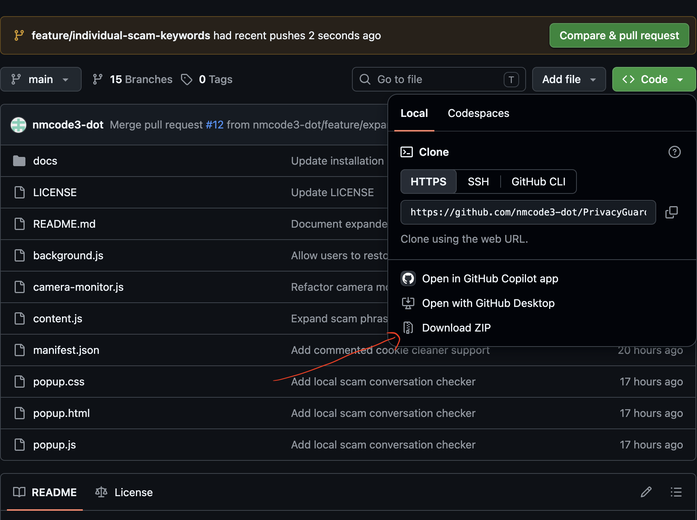
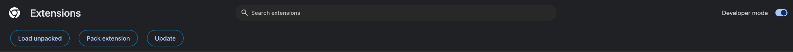
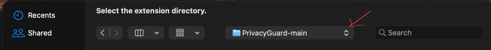

# PrivacyGuard - Nishil Mehta, OCSEF Hacks

## Presentation Slides
[https://docs.google.com/presentation/d/1KRgFGqFC89veNG9EQ6q1q8wUzXJ2QKe-GzUtfrp6vAI/edit?usp=sharing
](url)

A Chrome extension that helps people spot privacy risks before they share information or interact with websites. Made for OCSEF Hacks Hackathon.

## Download steps
### 1) Download Github Zip Extension File

### 2) Go to chrome://extensions

### 3) Load the unpacked file by turning on developer mode

### Choose the Privacy Guard UNZIPPED Foler

### The extension has been set up if all steps done properly

## Features

### Website risk rating

- Shows a 0–100 indicator on the site safety for the current tab when the extension popup is opened. Notifies the user if its <50.
- Checks URL-only warning signs locally, including missing HTTPS, embedded credentials, punycode domains, raw IP addresses, unusually long domains, and suspicious account/payment wording in the hostname. User is notified instantly upon entrance to site.
- Explains which signals affected the rating, and possible signs of scams, malware, and dangerous bots.
- Does not send browsing history or page URLs to a server.

The score is a simple estimation, not a instant determinant of a site's genuine safety. It does not verify site ownership, inspect a site's full behavior, or guarantee that a website is safe. A site with a high score may still be malicious, and a legitimate site may receive a warning.

### Sensitive-information detection

- Email addresses
- Common US phone number formats
- US Social Security number patterns
- Possible payment card numbers (validated with the Luhn checksum)
- Password, passcode, and verification-code phrases when followed by a value
- Common API keys and access tokens (recognizable GitHub, Slack, AWS, and `sk-` formats)
- Private cryptographic key headers
- Possible bank account or routing numbers when introduced by a matching phrase

### Scam conversation checker

- A user-triggered scan checks up to 30,000 characters of visible page text against **4,000 ranked, single-word entries** across eight scam-related categories.
- Words are matched individually (whole-word matching), not as long phrases. Results are ranked from **Clear sign** and **Strong sign** down to **Moderate**, **Small**, and **Weak sign**.
- The original 4,000 phrase combinations reuse many of the same words; converting them produces 160 distinct buzzwords across the 4,000 ranked entries. Repeated entries are retained so the original 4,000-entry total is preserved.
- The scan runs locally in the browser. It does not send or store conversation text.
- A word is only a clue, not proof that a message is a scam. Common words can appear in harmless conversations, and scammers may use words that are not in the list. Review the surrounding message and verify identity through an official channel before sharing money or sensitive information.

### Gmail support

PrivacyGuard includes best-effort support for Gmail's custom compose editor and Send button, including the Ctrl/Cmd+Enter shortcut. It reads the subject and message body when it can identify them. Gmail's interface changes over time, so this integration must be tested against current Gmail behavior and is not guaranteed to intercept every send path.

### Camera protection

- A page-world monitor observes calls to `navigator.mediaDevices.getUserMedia()` that request video and reports when a live video track starts or ends.
- The extension displays an alert while a camera stream is active in that tab.
- The alert offers **Block camera on this site**. This sets Chrome's camera content setting for that website to Block and asks the page monitor to stop the active video tracks.
- This does not take pictures, record video, or upload camera data.
- Coverage is best-effort: a page may bypass the hook, and this does not detect camera use by native apps, other browsers, operating-system services, or every browser/worker context. Chrome's own camera indicator and site permission controls remain important.

## Privacy

- Detection and website URL checks run locally in the browser.
- No API key, account, paid service, external AI model, or backend is required.
- Message text and browsing URLs are not uploaded by PrivacyGuard.
- Password input fields are deliberately excluded from sensitive-text scanning.
- The extension does not store detected values.

## Install locally

1. Download or clone this repository.
2. Open `chrome://extensions` in Google Chrome.
3. Turn on **Developer mode** at the top right of the page
4. Select **Load unpacked**.
5. Choose the unzipped project folder.
6. Refresh any open Gmail tabs after reloading the extension.

## Development

No build step or external dependencies are required.

## Understanding the Chrome extension manifest

The `manifest.json` file tells Chrome how to load PrivacyGuard. JSON does not support comments, so explanations for its settings are documented here instead of being inserted into that file.

- `manifest_version: 3`: Uses Chrome's Manifest V3 extension format.
- `name`, `version`, and `description`: Provide the extension's display name, version number, and short description.
- `action.default_title`: Sets the title shown for the PrivacyGuard toolbar action.
- `action.default_popup`: Opens `popup.html` when the user clicks the extension icon.
- `content_scripts`: Tells Chrome which scripts to load on matching webpages.
  - The first entry loads `content.js` after the page has loaded enough for the document to be available.
  - The second entry loads `camera-monitor.js` at the start of page loading in the page's MAIN JavaScript world. It also runs in all frames where Chrome allows it.
- `permissions`: Requests the extension APIs it uses. `contentSettings` lets the background script change a site's camera permission; `activeTab` allows the popup to inspect the active tab after the user invokes the extension; `cookies` lets the popup find and remove a limited list of likely analytics/advertising cookies on the current site.
- `background.service_worker`: Identifies `background.js` as the extension's service worker, which handles extension messages and browser-level actions.
- `host_permissions`: Allows the extension's content scripts to be injected on matching website URLs. Chrome may still restrict special browser pages and other protected contexts.

## Cookie cleaner

The popup includes a user-triggered cookie cleaner for the current website. It checks for a limited list of cookie names commonly associated with analytics and advertising, then removes only matching cookies when the user clicks the button. It does not clear all cookies, and it skips partitioned cookies.

Cookie names are only clues: a matching cookie is not guaranteed to be unnecessary, and some sites may use analytics cookies for features or preferences. The cleaner does not inspect cookie values or send cookie data anywhere. It is not an automatic background cleaner and does not promise to remove every tracking cookie.

### Page content risk analysis
- The website rating now combines URL checks with a local inspection of the current page's links, forms, downloads, embedded frames, external scripts, automatic redirects, and visible scareware/deceptive-ad wording.
- It flags executable downloads, suspicious or shortened links, mismatched link labels and destinations, cross-site password forms, hidden external frames, and unusual third-party resource patterns.
- Page inspection runs when the popup opens and can be repeated with **Rescan page**. It does not open links, download files, execute scripts, or upload page content.
- Third-party ads, scripts, and downloads are not automatically malicious. This is a heuristic warning system, not antivirus software or a reputation service; it can miss threats and produce false positives.
